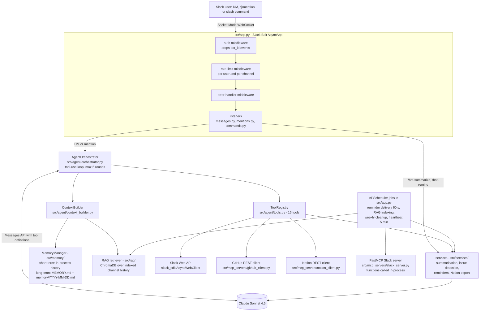

# Slack Workflow Agent

A Slack agent built on native Claude tool use, without an agent framework: 16 tools across Slack, GitHub and Notion; 267 unit tests in CI.
Ask it in a DM or with an @mention to summarise a channel, spot bugs in a conversation and file them as GitHub issues, write a Notion page, or set a reminder.
It has been run in a test Slack workspace only.

Memory layout (MEMORY.md + daily notes) is inspired by the open-source OpenClaw project.

The code lives in [`agent/`](agent/). Setup detail: [`agent/QUICK_START.md`](agent/QUICK_START.md).

---

## Architecture



How a DM is handled: Bolt receives the event over Socket Mode, the three middleware functions run in order, and the message listener validates and sanitises the text. The orchestrator asks the `ContextBuilder` for recent conversation history, long-term memory and ChromaDB matches, then calls Claude with the tool definitions. Each `tool_use` block is executed through the `ToolRegistry` and the result goes back to Claude as a `tool_result`, for up to five rounds; if the limit is reached, a final call without tools forces a text reply. The exchange is written to short-term memory and the daily markdown log.

## Tools

Defined in [`agent/src/agent/tools.py`](agent/src/agent/tools.py). Ten are always registered; the six marked "token" are registered only when `GITHUB_TOKEN` or `NOTION_TOKEN` is set, so Claude never sees a tool it cannot use.

| # | Tool | Area | Registered | What it does |
|---|---|---|---|---|
| 1 | `get_channel_messages` | Slack | always | Messages from a channel over the last N hours |
| 2 | `post_message` | Slack | always | Post a message to a channel |
| 3 | `schedule_message` | Slack | always | Schedule a message for a Unix timestamp |
| 4 | `list_channels` | Slack | always | Channels the bot belongs to |
| 5 | `get_channel_info` | Slack | always | Channel name, privacy and member count |
| 6 | `summarize_channel` | Slack | always | Claude summary of recent channel messages |
| 7 | `create_github_issue` | GitHub | token | Create an issue in `owner/repo` |
| 8 | `list_github_issues` | GitHub | token | List issues, filtered by state |
| 9 | `create_notion_page` | Notion | token | Create a page from markdown |
| 10 | `create_notion_page_from_messages` | Notion | token | Turn recent channel messages into a Notion page |
| 11 | `search_notion` | Notion | token | Search the Notion workspace |
| 12 | `detect_issues` | Issue detection | always | Claude reads recent messages and lists likely bugs with severity |
| 13 | `detect_and_create_issues` | Issue detection | GitHub token | Same, then files issues at or above a severity threshold |
| 14 | `schedule_reminder` | Reminders | always | Store a reminder in `memory_store/reminders.json` |
| 15 | `list_reminders` | Reminders | always | Pending reminders for a user |
| 16 | `cancel_reminder` | Reminders | always | Cancel a reminder (creator only) |

Slash commands, handled without the agent loop: `/bot-help`, `/bot-status`, `/bot-summarize #channel 24h`, `/bot-remind <text> in <time>`.

## Design decisions

- **Own the tool-use loop instead of using a framework.** The orchestrator calls the Anthropic Messages API directly and runs the `tool_use` → `tool_result` cycle itself, capped at five rounds. This keeps every step visible and easy to unit-test with a mocked client. The trade-off is that there is no built-in checkpointing, graph view or retry policy; those would have to be written by hand.
- **Middleware before the agent.** Bot-loop filtering, rate limiting and error handling run as Bolt middleware, so listeners and the agent only see events that passed those checks, and the rules live in one place.
- **Tool failures become data, not crashes.** `ToolRegistry.execute_tool` returns `{"error": ...}` instead of raising, the GitHub and Notion clients return `{"success": False, "error": ...}`, and the orchestrator marks exceptions inside the loop with `is_error`. Claude can then explain the failure to the user rather than the whole request failing.
- **One shared `MemoryManager`.** The orchestrator and the context builder use the same instance. An earlier version created two, so conversation history written by one was never read by the other; sharing the instance fixed it.
- **Markdown files for memory, ChromaDB for retrieval.** Long-term memory is plain markdown (`MEMORY.md` plus one file per day), easy to read and edit by hand. Channel history is indexed into a local ChromaDB collection on a schedule and searched by similarity. ChromaDB computes embeddings locally with its default model, so no embeddings API key is needed.
- **A FastMCP server for the Slack tools.** `src/mcp_servers/slack_server.py` exposes the Slack functions as MCP tools with `@mcp.tool()`. The agent itself does not talk to it over the MCP protocol: `tools.py` calls the Slack Web API directly, and the indexing job and Notion export import the server's functions in-process. GitHub and Notion use plain REST clients (`aiohttp`), not MCP.
- **Async throughout.** Bolt's `AsyncApp`, the Anthropic async client, `aiohttp` and APScheduler's asyncio scheduler share one event loop, so a slow GitHub or Claude call does not block other Slack events.

## Quick start

Needs Python 3.11+, a Slack app with Socket Mode enabled (scopes, events and slash commands are listed in [`agent/QUICK_START.md`](agent/QUICK_START.md)), and an Anthropic API key. GitHub and Notion tokens are optional.

```bash
cd 04.slack-workflow-agent/agent
python3.11 -m venv .venv && source .venv/bin/activate
pip install -e .                 # or: poetry install
cp .env.example .env             # fill in SLACK_BOT_TOKEN, SLACK_APP_TOKEN, SLACK_SIGNING_SECRET, ANTHROPIC_API_KEY
python src/main.py               # connects to Slack over Socket Mode
```

Optional helper scripts in `agent/scripts/`: `setup_test_channels.py` (posts sample conversations into a test workspace), `index_channels.py` (indexes channel history into ChromaDB now rather than waiting for the scheduled job) and `setup_vector_store.py`.

## Tests and CI

```bash
cd 04.slack-workflow-agent/agent
pip install -e . pytest pytest-asyncio
pytest tests -q
```

267 unit tests, all mocked: no Slack, Anthropic, GitHub or Notion credentials are needed. They passed locally on Python 3.11 (`267 passed`). The repository's GitHub Actions workflow ([`.github/workflows/tests.yml`](../.github/workflows/tests.yml), job "Slack workflow agent") runs the same commands on every push.

| Area | Tests |
|---|---|
| Utilities: validators, security helpers, exceptions | 102 |
| Services: issue detection, reminders, summarisation, Notion export | 85 |
| Memory: short-term, long-term, manager, retriever, schemas | 29 |
| Slack: listeners, slash commands, message service | 26 |
| RAG: store, indexer, retriever | 13 |
| Agent: orchestrator, tool registry | 12 |

`agent/test_integration.py` holds 9 further end-to-end checks that call the real Claude API. It needs an `ANTHROPIC_API_KEY`, so it is not part of CI. A manual checklist for a test workspace is in [`agent/docs/guides/E2E_TESTING_GUIDE.md`](agent/docs/guides/E2E_TESTING_GUIDE.md).

## Limitations

- **Test workspace only.** It has not been used by a real team, and there are no measured latency, cost or accuracy figures.
- **Signature verification comes from Slack Bolt.** `src/utils/security.py` has a custom HMAC-SHA256 `verify_slack_signature()` with unit tests, but no runtime code calls it. The bot runs in Socket Mode, where HTTP request signing does not apply; HTTP mode is not implemented.
- **MCP is partial.** The FastMCP server wraps the Slack functions, but the agent calls Slack, GitHub and Notion directly rather than over the MCP protocol.
- **Single process.** Rate-limit counters and short-term memory are in process memory, so they reset on restart and are not shared between instances. One workspace, one bot token; no OAuth install flow.
- **Thin agent-loop tests.** Most unit tests cover utilities and services; the orchestrator and tool registry have 12 between them.
- **Unpinned dependencies.** `pyproject.toml` uses caret ranges and no lock file is committed. `openai`, `redis` and `psycopg2-binary` are declared but not imported by the current code.
- No Dockerfile and no demo recording yet.

More detail: [security notes](agent/docs/security/SECURITY.md) · [module-by-module guide](agent/docs/guides/GUIDE.md) · [Claude Code agents, skills and rules](agent/.claude/README.md) written while building the project.

## Licence

MIT; see [LICENSE](../LICENSE) at the repository root.
