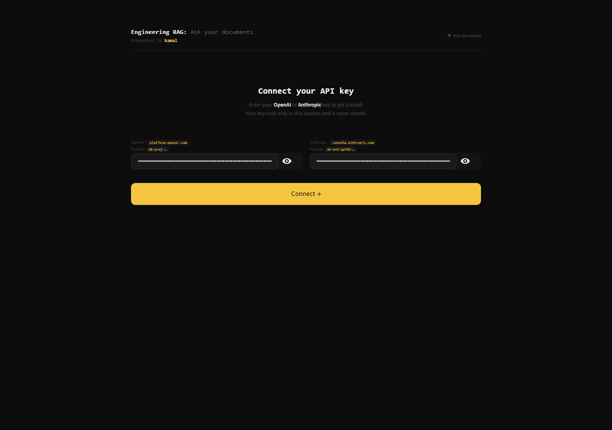
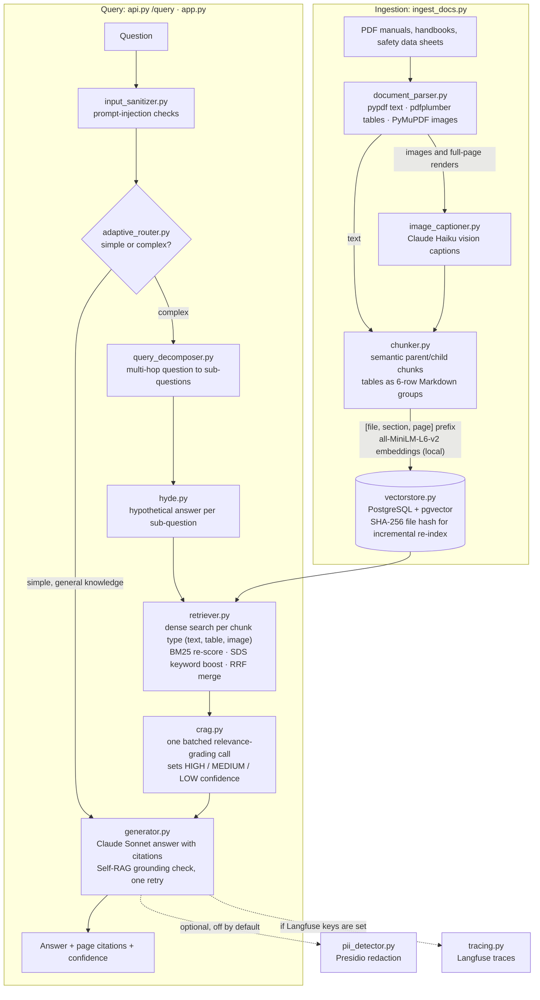

# Multimodal RAG for engineering documents

**Question answering over engineering PDFs where the answer is often in a table or a diagram rather than the prose, with page citations and a confidence level on every answer.**
Re-tested on the same 50 questions after every change: best run **3.87 / 5** (Claude Haiku as judge), multi-hop answers up from 2.63 to 3.27 under that same judge, and one regression (run 5) caught, traced to its cause and reverted.

FastAPI · Streamlit · PostgreSQL + pgvector · Claude Sonnet and Haiku · Langfuse tracing · 147 tests in CI

[](https://github.com/pkamalprasath/GenAI_Engineer/actions/workflows/tests.yml)



*Streamlit UI start screen: the user connects an OpenAI or Anthropic key, then asks questions of the indexed documents.*

---

## Architecture

Built from the modules in `src/`. `api.py` (FastAPI) and `app.py` (Streamlit) both call the same query pipeline.



---

## Results

Five full runs. Each run re-ingested the documents and answered the same 50 questions: 10 each of text, table, image, multi-hop and unanswerable (`src/evaluation/test_questions.py`). Every answer was scored 1–5 by an LLM judge.

| Run | What changed | Judge | Overall /5 | Multi-hop /5 | Chunks | Avg latency / query |
|---|---|---|:---:|:---:|---:|---:|
| 1 | Baseline | gpt-4o-mini | 3.13 | 2.00 | 757 | 15.0 s |
| 2 | Contextual chunk prefix, BM25, full-page render, batched CRAG (−3 s per query) | gpt-4o-mini | 3.59 | 3.73 | 1,272 | ~8 s |
| 3 | Generator and judge switched to Claude Haiku; Haiku image captions | Claude Haiku | 3.65 | 2.63 | 1,289 | ~5 s |
| 4 | Claude Sonnet generation, query decomposition, parent-child chunks | Claude Haiku | **3.87** | 3.27 | 2,364 | 21.3 s |
| 5 | SDS keyword boost, table chunks 6→4 rows, Sonnet captions (refused 257 of 359 images): regression, reverted | Claude Haiku | 3.65 | 3.00 | 2,259 | 21.5 s |

- **Runs 1–2 and 3–5 used different judges, so compare within those groups.** The like-for-like gains are run 1 → 2 (3.13 → 3.59, gpt-4o-mini judge, several changes together) and run 3 → 4 (3.65 → 3.87 overall, 2.63 → 3.27 multi-hop, Claude Haiku judge).
- 50 questions, 10 each of text, table, image, multi-hop and unanswerable. Run 4 by category: text 3.67, table 4.30, image 3.37, multi-hop 3.27, unanswerable 4.73.
- Run 4 latency about 21 s per query. Estimated cost ~$0.022 per query (approximate token counts × list prices, not billed spend); ~$1.29 to ingest the 3 PDFs.
- The best score came from the 2,364-chunk index of run 4. A later 2,528-chunk index (run 6: Haiku captions and 6-row tables restored, CRAG keeps borderline chunks for multi-hop questions) has been built but **not evaluated**.
- The judge (Haiku) and the generator (Sonnet) in runs 4–5 are from the same model family, which may favour their answers.
- Latencies and costs come from the run notes in [`results/PIPELINE_DEEP_DIVE.md`](results/PIPELINE_DEEP_DIVE.md); per-question outputs are not committed.

<details>
<summary>All five categories, all runs</summary>

| Category | Run 1 | Run 2 | Run 3 | Run 4 | Run 5 |
|---|:---:|:---:|:---:|:---:|:---:|
| Judge | gpt-4o-mini | gpt-4o-mini | Claude Haiku | Claude Haiku | Claude Haiku |
| Text | 3.30 | 3.77 | 3.43 | 3.67 | 4.13 |
| Table | 3.30 | 4.20 | 4.10 | 4.30 | 3.93 |
| Image | 2.70 | 2.77 | 3.30 | 3.37 | 2.53 |
| Multi-hop | 2.00 | 3.73 | 2.63 | 3.27 | 3.00 |
| Unanswerable | 4.40 | 4.23 | 4.77 | 4.73 | 4.67 |
| **Overall** | **3.13** | **3.59** | **3.65** | **3.87** | **3.65** |

</details>

**What run 5 taught me.** Run 5 changed three things at once and fell from 3.87 to 3.65. The image score dropped from 3.37 to 2.53 because the Sonnet captioner refused 257 of 359 images, and the smaller table chunks split value ranges. All three changes were reverted for run 6. Next time I would change one thing per run.

---

## Key design decisions and trade-offs

| Decision | Why | Trade-off |
|---|---|---|
| **PostgreSQL + pgvector** rather than a dedicated vector database | SQL filters on document type and chunk type, one Docker container, and the same database runs in CI. In my [benchmark sweep](../../experiments/) the vector store did not change answer quality. | Approximate (HNSW) search; retrieval recall was not measured separately. |
| **Local `all-MiniLM-L6-v2` embeddings** | Matched the top score in the benchmark sweep (5.0 against 4.93 for `text-embedding-3-small`), with no API cost or network call. | 384 dimensions; not re-tested on engineering text. |
| **Separate search per chunk type** (text, table, image caption), merged with reciprocal rank fusion | Stops long prose chunks crowding out the table row or diagram caption that holds the answer. | More queries per question. |
| **BM25 re-scores the dense candidates** | Catches exact identifiers such as standard numbers and part codes, which embeddings blur. | It is not a separate keyword index, so it cannot recover a chunk that dense search missed. |
| **Tables as 6-row Markdown groups**, header repeated in each | Keeps rows and units together. Run 5's 4-row groups split value ranges, and the table score fell from 4.30 to 3.93 (with other changes in the same run). | More table chunks to embed and search. |
| **Claude Haiku for image captions**, not Sonnet | Haiku captioned 354–359 of 359 images; Sonnet refused 257 of them in run 5. | Spatial diagrams still score poorly (see Limitations). |
| **Query decomposition + Claude Sonnet generation** | Multi-hop rose from 2.63 to 3.27 and overall from 3.65 to 3.87 (run 3 → 4, same judge). | Latency rose to about 21 s per query and estimated cost to ~$0.022 per query. |
| **Batched CRAG grading** (one call instead of five) | About 3 s saved per query (run 2). If the batch call fails, every chunk is marked ambiguous rather than the query failing. | One bad batch response affects every chunk in that query. |
| **No cross-encoder re-ranker** | No quality gain in the benchmark sweep, and 2.7–21 s added per query. | Not re-tested on this corpus. |
| **Adaptive router** sends simple general-knowledge questions straight to the model | Saves retrieval time and cost on questions the documents do not cover. | Those answers carry no citations, and a misrouted question skips the documents. |
| **Presidio PII redaction is optional and off by default** (`PII_REDACTION_ENABLED=false`) | Presidio needs an extra spaCy model and adds latency, so it is enabled only when needed. | It must be switched on, and tested, before use on documents that contain personal data. |

---

## Quick start

Requires Python 3.11+, Docker, and an Anthropic or OpenAI API key. The evaluated configuration (runs 3–5) uses Anthropic; without that key the code falls back to OpenAI models.

```bash
# 1. Start PostgreSQL + pgvector (credentials match configs/settings.py defaults)
docker compose up -d

# 2. Install dependencies
python -m venv .venv
source .venv/bin/activate          # Windows: .venv\Scripts\activate
pip install -r requirements.txt

# 3. Configure
cp .env.example .env               # then set ANTHROPIC_API_KEY and/or OPENAI_API_KEY

# 4. Ingest your PDFs (put them in data/; unchanged files are skipped on re-runs)
python ingest_docs.py data/
python ingest_docs.py data/ --no-images     # faster, skips image captioning

# 5a. Chat UI
streamlit run app.py               # http://localhost:8501

# 5b. Or the REST API (POST /query, POST /ingest, GET /health, GET /stats)
uvicorn api:app --reload           # http://localhost:8000
curl -X POST http://localhost:8000/query \
     -H "Content-Type: application/json" \
     -d '{"question": "What must be done before starting the pump for the first time?"}'
```

**Run the 50-question evaluation** (needs the documents already ingested; a full run costs about $1.10 by the same estimate as above):

```bash
python -c "
from src.evaluation.benchmarks.custom_loader import load_custom
from src.evaluation.benchmarks.runner import BenchmarkRunner
BenchmarkRunner().run('custom', load_custom(max_samples=50), cleanup_after=False)
"
```

`scripts/run_benchmarks.py` runs the public benchmarks (SQuAD, HotpotQA, Natural Questions, MS MARCO); `scripts/download_benchmarks.py` fetches them.

To enable PII redaction: set `PII_REDACTION_ENABLED=true` and run `python -m spacy download en_core_web_sm`. To enable tracing: set `LANGFUSE_PUBLIC_KEY` and `LANGFUSE_SECRET_KEY`. [`docs/SETUP.md`](docs/SETUP.md) has the full setup guide and every environment variable.

---

## Tests

147 test functions in `tests/` (86 in `test_modules.py`, 44 in `test_benchmarks.py`, 17 in `test_pipeline.py`). The GitHub Actions workflow runs them on every push against a `pgvector/pgvector:pg16` service container.

```bash
docker compose up -d
pytest tests -q
```

---

## Limitations

| Area | Limitation |
|---|---|
| Evaluation | One LLM judge, 50 questions, no human-labelled subset, no repeated runs to measure judge variance. Runs 1–2 used a different judge from runs 3–5. |
| Reproducibility | The three evaluated PDFs (a centrifugal pump manual, a *Machinery's Handbook* excerpt and a Chevron safety data sheet) are third-party documents and are not committed, and neither are the per-question outputs. Only the summary reports in `results/` are. |
| Latency | About 21 s per query in runs 4–5: interactive, but slow. |
| Spatial diagrams | Alignment and orientation diagrams score 1.3–2.3; captions describe parts but not how they relate. |
| Arithmetic multi-hop | Questions that need a calculation (total bolts, % reduction) score about 1.3–2.3; the pipeline retrieves facts but does not compute. |
| Warning labels | Stuck at 1.3 in every run; text on label images is not reliably read. |
| Cross-document multi-hop | Combining the safety data sheet with the pump manual is still inconsistent. |
| Scanned PDFs and multi-page tables | No OCR step runs; tables that span pages are treated as separate tables. |
| API security | Rate limiting, input sanitising and CORS restricted to localhost, but no authentication on `/query` or `/ingest`. Local use only. |
| Dependencies | `requirements.txt` is not version-pinned. |

## What's next

1. Re-score runs 1–2 with the Claude Haiku judge, so the whole series is like-for-like.
2. Evaluate the run 6 index (2,528 chunks).
3. Hand-label a subset of answers to measure how far the LLM judge agrees with a human.
4. Commit per-question outputs for every run.
5. Change one thing per run.

## Credits

The retrieval techniques follow published papers: HyDE, Corrective RAG (CRAG), Self-RAG, Adaptive-RAG and reciprocal rank fusion. My notes on them are in [`../../research-papers/`](../../research-papers/). The pipeline calls the Anthropic and OpenAI SDKs directly; LangChain is used only for the semantic chunker and the synthetic-question benchmark.
