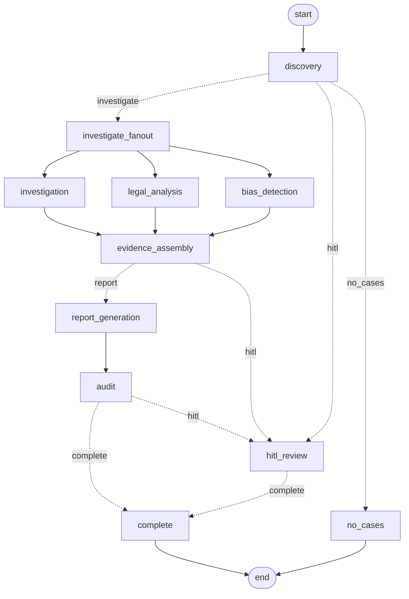

# SENTINEL v2: multi-agent review of lending decisions (LangGraph)

Reviewing lending decisions for fair-lending problems means checking each decision's data, history and outcome against the rules, and only a person should sign off the uncertain cases.
SENTINEL is an 11-node LangGraph workflow that runs 3 agents in parallel (provenance, legal, bias), picks cases with a BM25 → DistilBERT → local Llama 3.2 triage so only borderline cases reach a language model, and sends a case to human review when report confidence is below 0.85.
Every decision record carries a SHA-256 content hash, so a changed record is detected when its provenance chain is read. All data is synthetic; the rules covered are US fair-lending rules (ECOA, HMDA and related).

[](https://github.com/pkamalprasath/ai-engineering-portfolio/actions/workflows/tests.yml)

---

## Architecture

The diagram below is the LangGraph graph from `sentinel/graph/builder.py`, generated with `build_graph().compile().get_graph().draw_mermaid()` (layout tidied). Dotted arrows are conditional edges; the routing functions are in `sentinel/graph/edges.py`.



**6 agents, 11 nodes.** The agents are discovery, investigation (provenance), legal analysis, bias detection, report and audit. The other five nodes are plumbing: the fan-out, evidence assembly (fan-in), human review, complete and no-cases. Investigation, legal analysis and bias detection run in parallel.

| Node | What it does | Code |
|---|---|---|
| discovery | Selects relevant decision records: BM25 pre-filter → DistilBERT re-ranking → llama3.2:3b (Ollama) for borderline scores only | `sentinel/agents/discovery_agent.py`, `sentinel/agents/classifiers/` |
| investigation | Loads the provenance chain for each case and checks SHA-256 content hashes | `sentinel/agents/investigation_agent.py`, `sentinel/provenance/` |
| legal_analysis | Retrieves regulation sections from pgvector (tool call) and maps findings to them; returns verdict and risk | `sentinel/agents/legal_agent.py`, `sentinel/tools/regulation_tools.py` |
| bias_detection | Approval-rate disparity per dimension (flag above 0.15), plus Isolation Forest (`anomaly_backend: hybrid`) | `sentinel/agents/bias_detection_agent.py` |
| evidence_assembly | Fan-in; routes to human review on HIGH/CRITICAL risk, detected bias or low discovery confidence | `sentinel/graph/builder.py`, `edges.py` |
| report_generation | Drafts the report; the output guard checks every cited provenance node exists, scans for PII and applies the 0.85 confidence gate | `sentinel/agents/report_agent.py`, `sentinel/guardrails/output_guard.py` |
| audit | Writes the investigation's events to `audit_log` | `sentinel/agents/audit_agent.py` |
| hitl_review | Pauses the graph with LangGraph `interrupt()`; state is checkpointed in PostgreSQL and resumed by the escalation API | `sentinel/graph/builder.py` |

**Services** (`docker-compose.yml`, 5 services): `redis` (arq job queue), `api` (FastAPI, host port 8003), `worker` (arq worker), `scheduler` (proactive investigations), `dashboard` (Streamlit, port 8501). PostgreSQL with pgvector is external (set `DATABASE_URL`), and Ollama runs on the host.

**Models** (`configs/models.yaml`): llama3.2:3b via Ollama for classification and as fallback; gpt-4o-mini for reasoning and report synthesis by default (switchable to Anthropic Claude in the same file); OpenAI `text-embedding-3-small` for regulation search.

---

## Key engineering decisions and trade-offs

### 1. BM25 → DistilBERT → llama3.2:3b: three-stage discovery
Sending every decision to a hosted LLM to judge relevance costs tokens for every record, hits context limits, and gives relevance judgements that cannot be reproduced. Instead:

```
BM25 (local, deterministic)         → drops clearly irrelevant records
DistilBERT (local, CPU)             → cosine-similarity re-ranking of the survivors
llama3.2:3b (local, via Ollama)     → judges only the borderline cases
```
Every selection can be traced to a deterministic score, except the borderline calls, which are logged.

**Trade-off:** DistilBERT is held in memory once loaded, and the local LLM call is the slowest stage. `classifier_backend` in `configs/agents.yaml` can be set to `bert` (BM25 + DistilBERT, no LLM) or `llm` (LLM only) to trade accuracy against speed.

### 2. LangGraph rather than a plain agent loop
LangGraph's checkpointer lets the graph pause mid-run for human review, save its state to PostgreSQL and resume at the same node after a reviewer responds. A plain loop loses in-flight state when it stops.

**Trade-off:** every node's state is serialised to the checkpoint, which adds latency per node. That is acceptable for a review workflow, not for real-time use.

### 3. Parallel fan-out for investigation, legal and bias
The three agents do not use each other's output, so they run concurrently and write to `operator.add` list fields that merge safely at the fan-in.

**Trade-off:** concurrent LLM calls raise peak API usage; under tight rate limits one branch can slow the others.

### 4. Separate PII entity lists for input and output
The input guard redacts names, locations, dates, emails, SSNs and similar. The output guard uses a narrower list (SSN, email, phone, bank number, credit card), because a report legitimately contains census tracts and regulation dates. One shared list blocked valid reports.

### 5. pgvector for regulation search (not FAISS)
Regulation embeddings sit in the same PostgreSQL database as their metadata: no separate index service, and a newly ingested regulation is available to the next investigation without a restart.

**Trade-off:** the corpus here is small (16 sections from 5 US finance regulations), so search speed is not a concern. A much larger corpus would need index tuning or a dedicated vector store.

### 6. One YAML source for configuration
Model names, thresholds, bias dimensions, PII lists and rate limits live in `configs/*.yaml`. Changing the human-review threshold or the LLM provider is a config edit and a restart, not a code change.

---

## Quick start

Prerequisites: Python 3.11, PostgreSQL with the pgvector extension (local or hosted), Redis, [Ollama](https://ollama.com), and an OpenAI API key (embeddings and default reasoning model).

```bash
git clone https://github.com/pkamalprasath/ai-engineering-portfolio.git
cd ai-engineering-portfolio/07.langgraph-compliance-agents/2.sentinel_v2

python -m venv .venv && source .venv/bin/activate
pip install torch --index-url https://download.pytorch.org/whl/cpu
pip install -r requirements.txt

cp .env.example .env                         # set DATABASE_URL, OPENAI_API_KEY, SENTINEL_API_KEY

# Database schema (plain SQL migrations)
for f in sentinel/db/migrations/001_initial_schema.sql \
         sentinel/db/migrations/002_add_applicant_data.sql \
         sentinel/db/migrations/002_regulation_documents.sql \
         sentinel/db/migrations/003_hnsw_indexes.sql; do
  psql "$DATABASE_URL" -f "$f"
done

# Local models
ollama pull llama3.2:3b

# Synthetic data and regulation embeddings (same as `make seed`)
python scripts/generate_synthetic_data.py    # 500 synthetic decisions -> data/synthetic/decisions.json
python scripts/seed_database.py              # load decisions and provenance nodes
python scripts/ingest_regulations.py         # embed data/regulations/finance/*.yaml into pgvector

# Run (separate terminals; same as `make api` and `make dashboard`)
python -m uvicorn sentinel.api.main:app --port 8003
python -m streamlit run sentinel/dashboard/app.py --server.port 8501
```

Open http://localhost:8501. API docs are at http://localhost:8003/docs.

**Docker Compose:** `docker compose up -d` builds the 5 services above. It has not been re-tested since this folder was reorganised, and its network is marked `internal: true`, which can stop containers reaching an external database or the host's Ollama; adjust it if you use Compose.

### API example

```bash
curl -X POST http://localhost:8003/api/v1/investigations \
  -H "X-API-Key: $SENTINEL_API_KEY" -H "X-Tenant-ID: bank-acme" \
  -H "Content-Type: application/json" \
  -d '{"query": "Review credit decisions Jan 1-15 2024 for ECOA fair lending compliance",
       "date_from": "2024-01-01", "date_to": "2024-01-15", "domain": "finance"}'
# returns {"investigation_id": "...", "status": "queued"}

curl http://localhost:8003/api/v1/investigations/<id> \
  -H "X-API-Key: $SENTINEL_API_KEY" -H "X-Tenant-ID: bank-acme"

# Human review of an escalated case
curl -X POST http://localhost:8003/api/v1/escalations/<id>/resolve \
  -H "X-API-Key: $SENTINEL_API_KEY" -H "X-Tenant-ID: bank-acme" \
  -H "Content-Type: application/json" \
  -d '{"response": "Reviewed; confirm finding.", "action": "approve_draft", "reviewer_id": "officer-01"}'
```

Other endpoints: `GET /api/v1/escalations`, `GET /api/v1/provenance/{id}/trace`, `GET /api/v1/analytics`, `GET|POST /api/v1/regulations`, `GET /health`, `GET /ready`.

More detail: [docs/SETUP.md](docs/SETUP.md), [docs/ARCHITECTURE.md](docs/ARCHITECTURE.md), [docs/MANUAL_TESTING_GUIDE.md](docs/MANUAL_TESTING_GUIDE.md), [docs/CURL_TESTING_CHEATSHEET.md](docs/CURL_TESTING_CHEATSHEET.md), [docs/DIAGNOSTICS.md](docs/DIAGNOSTICS.md).

---

## Tests and CI

| Suite | Test functions (`def test_`) | Needs |
|---|---|---|
| `tests/unit/` | 121 | nothing external |
| `tests/integration/` | 64 | nothing external (graph stubs and mocks) |
| `tests/security/` | 34 | nothing external |
| `tests/performance/` | 9 | nothing external |
| **Total collected by pytest** | **228 functions, 263 test cases** (with parametrisation) | |

```bash
pytest tests -q                    # what CI runs
```

GitHub Actions (`.github/workflows/tests.yml` at the repo root) runs `pytest tests -q` for v1 and v2 on Python 3.11. None of these tests needs PostgreSQL, Ollama or an API key.

### End-to-end scenarios (scenario pass rate: pending re-run)

`tests/automated_e2e_tests.py` sends 7 labelled scenarios (fair lending, disability, ECOA) through the running API and compares the verdict and risk level with the expected values. A scenario passes only if **both** match and a report is produced; the script exits non-zero otherwise. An earlier version counted a scenario as passed whenever any verdict came back, so its reports overstated the result; those reports have been deleted and the scoring is now unit-tested (`tests/unit/test_e2e_scoring.py`).

**The scenario pass rate has not been re-measured since the fix and will be published here after a re-run.** To reproduce (needs PostgreSQL, Ollama and an OpenAI key, with the API running as in Quick start):

```bash
export SENTINEL_API_URL=http://localhost:8003
export SENTINEL_API_KEY=<same key as in .env>
python tests/automated_e2e_tests.py
# writes test_results/test_report_*.txt, test_results_*.json and scenario_table_*.md
```

---

## Limitations

- **Synthetic data only.** The 500 decisions come from `scripts/generate_synthetic_data.py`, with injected patterns (for example, 30 census tracts flagged for the bias tests). Nothing here has been run on real lending data.
- **US rules only.** The regulation corpus is 16 sections from ECOA, FCRA, HMDA, the Fair Housing Act and CRA (`data/regulations/finance/`). The `pharma` and `generic` domain configs have no regulation data behind them yet.
- **Not legal advice.** The verdicts are model output over a small regulation corpus. They are not a compliance opinion and have not been checked by a lawyer or validated against any regulator's requirements.
- **Scenario pass rate pending.** See above; 7 hand-labelled scenarios are too few to measure accuracy in any case.
- **Tenant-scoped data model, not tenant isolation.** Records carry a `tenant_id` and queries filter on it, but the tenant comes from the client-supplied `X-Tenant-ID` header (default `demo-tenant`) and there is one shared API key (`sentinel/api/middleware.py`). Binding the tenant to an authenticated key is not done.
- **No measured cost or latency figures.** Cost per call is recorded by `sentinel/observability/cost_tracker.py`, but no figures have been measured and published.
- **Dependencies are not pinned**, and the Compose file needs the network caveat above.

---

## Project layout

```
2.sentinel_v2/
├── configs/            models.yaml, agents.yaml, security.yaml, domains/
├── data/regulations/   regulation YAML (finance)
├── docs/               set-up, architecture, manual testing, diagnostics
├── scripts/            synthetic data, seeding, regulation ingestion, diagnostics
├── sentinel/
│   ├── agents/         the six agents + classifiers (BM25, DistilBERT, Isolation Forest)
│   ├── api/            FastAPI app and middleware
│   ├── dashboard/      Streamlit app (app.py + pages/)
│   ├── db/migrations/  SQL schema
│   ├── graph/          builder.py (11 nodes), edges.py (routing)
│   ├── guardrails/     input guard, output guard, PII detection
│   ├── mcp_servers/    MCP servers for investigation, provenance and regulation tools
│   ├── observability/  Langfuse tracing (no-op without keys), cost tracker, heartbeat
│   ├── provenance/     PROV-O style nodes and edges, SHA-256 hashing
│   ├── scheduler/      proactive scheduler
│   └── worker/         arq worker
├── souls/              agent system prompts
└── tests/              unit, integration, security, performance, e2e harness
```

v1 of this project is in [`../1.sentinel_v1`](../1.sentinel_v1) for history.

## Licence

MIT
